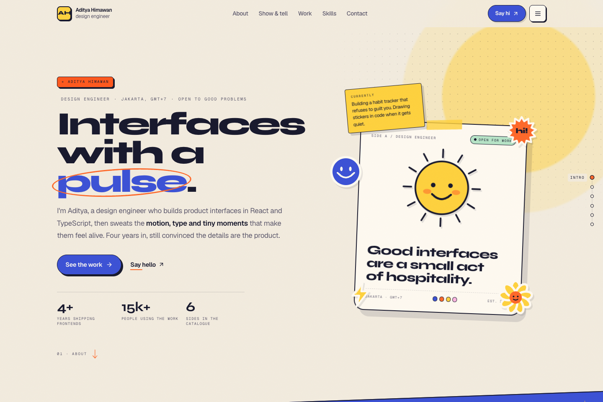
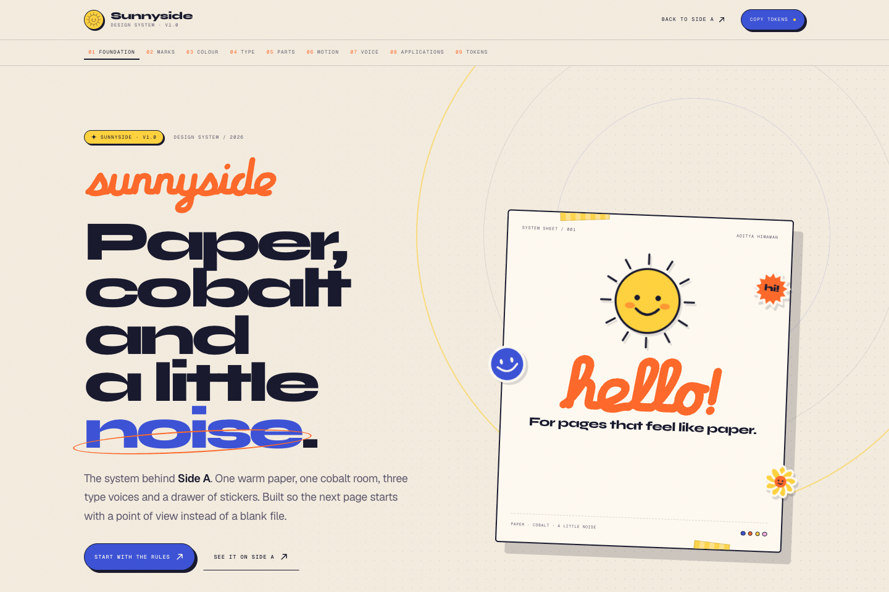

<div align="center">

# Sunnyside

**A portfolio, blog, and design-system playground for the details that make interfaces feel alive.**

[Live site](https://adityahimaone.space) · [Design system](https://adityahimaone.space/sunnyside) · [Projects](https://adityahimaone.space/projects) · [Blog](https://adityahimaone.space/blog)

</div>

<p align="center">
  
</p>

<p align="center"><sub>Side A — the studio landing page. The hero artwork is drawn in the interface, not a flattened background image.</sub></p>

<p align="center">
  <a href="https://adityahimaone.space/sunnyside">
    
  </a>
</p>

<p align="center"><sub><a href="https://adityahimaone.space/sunnyside">Sunnyside</a> — the live design-system specimen behind Side A.</sub></p>

> A design-engineering portfolio built around one idea: the small decisions are the interface.

## What’s inside

- **Studio landing page** — six chapters: Intro, About, Show & tell, Work, Skills, and Contact.
- **Sunnyside** — a browsable design-system guide with palette, type, components, motion, voice, applications, and copyable/downloadable tokens.
- **Design-system library** — five documented cases at `/design-system`: Sunnyside (paper and cobalt), Vitrine (glass and dither), Huginn Studio (print cells), Riso Co. (two-pass misregistration) and Hachure (survey paper and ordered dither). Each has a brief, a mark, tokens, a form kit and an honest audit.
- **Projects archive** — project releases, case studies, and GitHub activity.
- **Blog and guides** — Markdown writing about frontend work, self-hosting, and infrastructure, with filters, reading aids, RSS, and generated social images.
- **Bookmarks** — a searchable, paginated catalogue backed by Cloudflare D1, with an admin editor.
- **Music experiments** — interactive audio tools, visualizers, and a now-playing player.

## Sunnyside design system

Sunnyside is the visual language behind the studio landing page and archive surfaces. The `/sunnyside` route is its **reference and interactive specimen**, not a separately published component library. It documents the intended rules and provides CSS/JSON token exports; implementation styles remain scoped to their owning features rather than being forced through one global component package.

| Foundation        | Direction                                                                                                                                 |
| ----------------- | ----------------------------------------------------------------------------------------------------------------------------------------- |
| **Palette**       | Warm paper (`#f3ecdf`), ink (`#191a2e`), and one deliberate cobalt field (`#3d53d6`); tangerine, butter, pink, mint, and sky are accents. |
| **Typography**    | Syne for display, Geist for reading, Geist Mono for labels, and a small custom marker script for annotations.                             |
| **Shape**         | Dark outlines, paper layers, modest radii, and directional hard shadows instead of generic floating-card blur.                            |
| **Composition**   | Paper-first layouts, considered offsets, one loud field at a time; stickers punctuate content, never carry its structure.                 |
| **Motion**        | Movement should explain a change, orient the reader, or return feedback. Reduced-motion preferences are respected.                        |
| **Accessibility** | Contrast pairs and focus treatments are documented; decorative accent colours are not used as small body text.                            |

Vitrine is the second case, deliberately not a Sunnyside variant: a glass container, a halftone information layer, a V mark made of two panes, and ten native form controls. Its source lives in `features/vitrine/`, `design/brand/vitrine/` and `public/brand/vitrine/`; the audit is in `docs/vitrine-design-system-audit.md`. Do not import its `--vt-*` tokens into Sunnyside.

Hachure (Case 05) is the opposite test: no blur, no shadow, no rounded corner. It takes the supplied ridgeline dither footer as a **tone engine** and builds a cartographic system around density — survey stock, hachure, a benchmark mark, three elevation bands and a footer you can read an altitude off. Source: `features/hachure/`, `design/brand/hachure/`, `public/brand/hachure/`; audit: `docs/hachure-design-system-audit.md`.

The `/design-engineering` docs hub is the practice-facing companion: the loop, the four standards, the Sunnyside case, the capability atlas, the installable brand-system skill and the field notes. It is built for reading and for agents: a sticky contents column, stable heading anchors, real tables, and raw Markdown twins at `/design-engineering/llms.txt` and `/design-engineering/learning/llms.txt`.

The archive uses namespaced `--ss-*` tokens to avoid collisions with Tailwind/shadcn and page-local styles. The landing page and other areas still have their own scoped styling; the specimen is the clearest design reference, not a single runtime source consumed identically by every route.

## Logo and brand kit

The identity is a **die-cut sun sticker** and the site's **marker wordmark**. The mark is a cobalt tile with an ink edge, a butter sun with a face, twelve rays clipped by the rounded paper, and the same hard directional offset as every other Sunnyside surface. The wordmark is the marker hand frozen as outlines, so it never depends on a font loading. The one-line essence is **“A system with a face.”**

| Piece             | Rule                                                                                                          |
| ----------------- | ------------------------------------------------------------------------------------------------------------- |
| **Header lockup** | 34px mark · 10px gap · 87.7 × 25px wordmark · 8.5px name at 0.14em. Name drops below 480px, wordmark below 360. |
| **Clear space**   | Half the mark's height on every side — 17px at the 34px header size.                                          |
| **Minimums**      | 24px full mark, 16px compact mark, 72px wide wordmark, 130px wide lockup.                                     |
| **Favicon**       | Compact mark (no shadow, 8 rays) at 16/32/48 in the ICO, plus SVG and a 180px apple icon.                     |
| **Colour**        | Keep cobalt, ink, butter and tangerine fixed. The wordmark inherits ink. One loud field at a time.            |
| **Type**          | Syne 800 for display, Geist Mono 500 for labels at 0.14–0.2em, the marker hand for annotations.               |

**Do** use the supplied SVGs or the `SunnysideMark` / `SunnysideWordmark` components, keep the hard offset hard, and switch to the compact mark below 24px. **Don't** recolour the sun, swap the tile for another shape, add gradients or soft shadows, stretch or re-space the lockup, rotate beyond the 4° hover, retype the wordmark, or use the glyph (the sun without its tile) as a favicon.

- [Full guidelines](./design/brand/README.md) — construction, clear space, rules, implementation
- [Brand kit board](./design/brand/sunnyside-brandkit.png) — the 3 × 3 identity deck
- [Logo SVGs](./public/brand/) — lockups, marks, wordmark, favicon images
- [Logo component](./components/ui/sunnyside-logo.tsx) — `SunnysideMark`, `SunnysideWordmark`
- [Live specimen — Marks](https://adityahimaone.space/sunnyside#marks) — the same rules, with downloads

## Routes

| Route                            | Contents                           |
| -------------------------------- | ---------------------------------- |
| `/`                              | Studio landing page                |
| `/sunnyside`                     | Design-system specimen             |
| `/design-system`                 | Design-system case library         |
| `/design-system/vitrine`         | Vitrine — glass-and-dither case    |
| `/design-system/riso`            | Riso Co. — two-pass print case     |
| `/design-system/hachure`         | Hachure — cartographic dither case |
| `/design-engineering`            | Design-engineering docs hub         |
| `/design-engineering/learning`   | Field notes: Pen.dev, Figma, Craft  |
| `/design-engineering/llms.txt`   | Markdown twin of the docs hub       |
| `/design-engineering/learning/llms.txt` | Markdown twin of the field notes |
| `/projects` · `/projects/[slug]` | Project catalogue and case studies |
| `/blog` · `/blog/[slug]`         | Blog index and articles            |
| `/bookmarks`                     | Searchable bookmark catalogue      |
| `/skills`                        | Skills catalogue                   |
| `/music`                         | Audio playground                   |
| `/notes` · `/notes/[slug]`       | Notes                              |
| `/rss.xml`                       | Blog feed                          |

## Agent skills — brand system and implementation

The brand-kit, design-system and mockup method is packaged as three installable skills. `sunnyside-brand-system` owns the brief, logo family, board, favicons, tokens, typography, modern visual directions, universal surfaces, audit and handoff. `implement-brand-system` turns the approved kit into a single-page HTML/TSX proof with shadcn/Radix, forms, metadata and lean QA. `pen-dev` covers the `.pen` design-source workflow.

```bash
npx skills add adityahimaone/sunnyside --skill sunnyside-brand-system --full-depth
npx skills add adityahimaone/sunnyside --skill implement-brand-system --full-depth
npx skills add adityahimaone/sunnyside --skill pen-dev --full-depth
```

The package lives in [`skills/sunnyside-brand-system/`](./skills/sunnyside-brand-system/); start with [`SKILL.md`](./skills/sunnyside-brand-system/SKILL.md). The implementation companion is [`skills/implement-brand-system/`](./skills/implement-brand-system/) and the pen.dev companion is [`skills/pen-dev/`](./skills/pen-dev/). Typography is a first-class gate; the optional upstream companion is [better-typography](https://www.ui-skills.com/skills/jakubkrehel/better-typography). The public companion page is [`/design-engineering`](https://adityahimaone.space/design-engineering).

## Stack

| Area               | Tools                                                                              |
| ------------------ | ---------------------------------------------------------------------------------- |
| Framework          | Next.js 16 App Router, React 19, TypeScript 5                                      |
| Styling            | Tailwind CSS v4, CSS Modules                                                       |
| Motion             | Motion, GSAP, Lenis, browser animation APIs                                        |
| Graphics and audio | Three.js / React Three Fiber, Tone.js                                              |
| Content            | Markdown, generated at build time; `gray-matter`, `react-markdown`, `reading-time` |
| Data               | Cloudflare D1 for bookmarks; GitHub API for project activity                       |
| Deployment         | OpenNext for Cloudflare Workers; standalone Next.js build also supported           |
| Testing            | Jest, Testing Library, Playwright, ESLint                                          |

**Requirements:** Node.js 20.9 or newer and pnpm.

## Project layout

```text
app/                          App Router routes, layouts, metadata, API handlers
features/
  landing-page/studio/         Landing page chapters, art, and scoped styles
  design-system/              Sunnyside specimen, system data, token exports
  archive/                    Shared archive shell and namespaced design tokens
  blog/                       Markdown blog views and content logic
  projects/                    Project catalogue and detail views
  bookmarks/                  Search, pagination, and admin UI
  music/  mixtape/             Audio experiments and playback interfaces
components/ui/                Cross-feature UI primitives
content/blog/                 Markdown posts and frontmatter
public/                       Static assets and README screenshots
scripts/                      Content generation, CSS checks, build helpers
tests/  e2e/                   Jest unit tests and Playwright browser tests
```

UI belongs to the feature that owns it. `components/ui/` is reserved for primitives shared across features; `hooks/` and `lib/` contain logic used by multiple features. Routes stay thin and compose feature views.

## Run locally

```bash
pnpm install
cp .env.example .env.local
pnpm generate:content
pnpm dev
```

Open `http://localhost:3000`. `pnpm build` also generates blog content before building. The bookmark API uses Cloudflare D1; to exercise bookmark reads and writes locally, run the app with the project's Wrangler/OpenNext bindings configured.

### Environment

Set local values in `.env.local` and production secrets in the deployment environment. Never commit real credentials.

| Variable                                                              | Required                  | Purpose                                                                                                |
| --------------------------------------------------------------------- | ------------------------- | ------------------------------------------------------------------------------------------------------ |
| `ADMIN_USER`, `ADMIN_PASS`                                            | For bookmark admin writes | Admin login credentials. In production, missing credentials disable authenticated writes.              |
| `SPOTIFY_CLIENT_ID`, `SPOTIFY_CLIENT_SECRET`, `SPOTIFY_REFRESH_TOKEN` | No                        | Enables the Spotify now-playing surface; without them it degrades gracefully.                          |
| `NEXT_PUBLIC_SITE_URL`                                                | No                        | Canonical site origin; defaults to `https://adityahimaone.space`. Set explicitly for previews/staging. |
| `NEXT_PUBLIC_GA_MEASUREMENT_ID`                                       | No                        | Enables GA4 when provided.                                                                             |
| `NEXT_PUBLIC_GSC_VERIFICATION`                                        | No                        | Adds the Google Search Console verification token.                                                     |

See [`.env.example`](./.env.example) for the current template and notes.

## Content

### Add a blog post

Create `content/blog/my-post.md` with frontmatter:

```markdown
---
title: 'A useful title'
slug: my-post
date: 2026-10-26
description: 'A concise summary.'
tags: [nextjs, typescript]
published: true
---

Write the post in Markdown.
```

`pnpm generate:content` turns the Markdown files into the generated module used by the app. Keep that generated file out of commits; it is build output.

### Update projects and bookmarks

- Featured project metadata lives in `features/projects/constants/index.ts`; project case-study data lives in `data/`.
- Bookmarks are stored in D1 and maintained through the admin UI on `/bookmarks`; they are not edited in a checked-in JSON catalogue.
- Landing-page chapters, palette, and principles are in `features/landing-page/studio/`.
- Sunnyside specimen content and token exports are in `features/design-system/sunnyside-data.ts`.

## Commands

| Command                 | What it does                                                                |
| ----------------------- | --------------------------------------------------------------------------- |
| `pnpm dev`              | Start the local Next.js development server                                  |
| `pnpm generate:content` | Generate the blog content module                                            |
| `pnpm build`            | Generate content and build the production app, then run critical-CSS checks |
| `pnpm start`            | Start the built Next.js server                                              |
| `pnpm preview`          | Build and preview the Cloudflare Worker locally                             |
| `pnpm deploy`           | Build and deploy through OpenNext/Wrangler                                  |
| `pnpm test`             | Run Jest unit tests                                                         |
| `pnpm test:e2e`         | Run Playwright browser tests (requires a built app)                         |
| `pnpm lint`             | Run ESLint                                                                  |

For Playwright’s browser, install Chromium with `pnpm exec playwright install chromium` if it is not already available.

## Deployment

The primary deployment target is Cloudflare Workers via OpenNext. Configure the Worker, D1 database, R2 incremental-cache bucket, and production environment variables in Cloudflare, then use `pnpm deploy` (or the configured CI workflow). `pnpm preview` builds the same adapter output for local verification.

A standalone Next.js build is also available through `pnpm build:standalone`. The repository includes a separate VPS deployment script and rollback flow in [`deploy.sh`](./deploy.sh); its server-specific paths and secrets must be configured for that host.

## Design and project guidance

- [Current design reference](./design.md) — Sunnyside / Side A visual principles, palette, typography, accessibility, and implementation map.
- [Design-engineering docs notes](./docs/design-engineering.md) — the docs shell, domain model, skill package, gaps and open questions.
- [`AGENTS.md`](./AGENTS.md) — project-specific design and architecture guidance for coding agents.
- [`docs/`](./docs/) contains dated audits, implementation records, and historical proposals. Treat them as snapshots unless current code links to them; they do not override the live implementation or `design.md`.

## Conventions

- **Keep feature boundaries clear.** Cross-feature UI goes in `components/ui/`; feature-specific styling stays with the feature.
- **Prefer explicit exports.** Feature entry points name the exports they expose; internal files use relative imports.
- **Respect reduced motion.** Scroll and interaction effects should have an accessible reduced-motion path.
- **Treat design-system tokens as guidance with context.** Use the `/sunnyside` specimen for the system rules while preserving each feature’s scoped ownership.

## License

MIT
