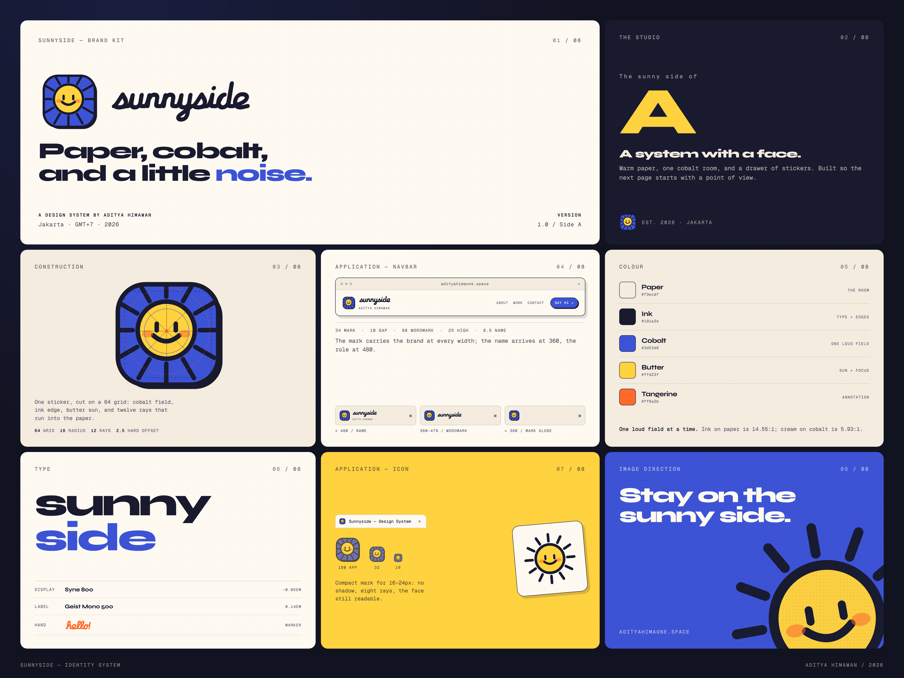

# Sunnyside — brand kit

The Sunnyside mark is a sun cut from the site's own sticker drawer: a cobalt tile,
an ink edge, a butter sun with a face, and twelve rays that run into the paper. The
wordmark is the design system's marker hand, frozen as outlines. Together they are
the identity for **Sunnyside / Side A**.

- **Essence:** A system with a face.
- **Cover line:** Paper, cobalt, and a little noise.
- **Tagline for campaigns:** Stay on the sunny side.

The kit is 4:3, drawn on a 2400 × 1800 grid and exported at 3000 × 2250. Source:
[`brandkit.html`](./brandkit.html) with fonts in [`assets/`](./assets/).

## What is in the kit

| Asset                             | Path                                         | Shape     | Use                                                        |
| --------------------------------- | -------------------------------------------- | --------- | ---------------------------------------------------------- |
| Primary horizontal lockup          | `public/brand/sunnyside-lockup.svg`          | 128.7 × 34 (3.78:1) | Header, print, anything that can carry the full name |
| Reversed lockup                   | `public/brand/sunnyside-lockup-reverse.svg`  | 128.7 × 34 | On ink or cobalt with a paper wordmark                     |
| Stacked lockup                    | `public/brand/sunnyside-lockup-stacked.svg`  | 72 × 88 (0.82:1) | Square covers, stamps, merchandise                  |
| Wordmark                          | `public/brand/sunnyside-wordmark.svg`        | 116 × 33 (3.51:1) | Footers, watermarks, places the mark already exists |
| Reversed wordmark                 | `public/brand/sunnyside-wordmark-reverse.svg` | 116 × 33 | Ink or cobalt grounds                                      |
| Primary mark                      | `public/brand/sunnyside-mark.svg`            | 1:1, 64 grid | Navbar, app icon, social avatar, stickers                 |
| Compact mark                      | `public/brand/sunnyside-mark-compact.svg`    | 1:1, 64 grid | 16–24px favicon and tiny UI; no shadow, 8 rays         |
| Sun glyph                         | `public/brand/sunnyside-glyph.svg`           | 1:1, 64 grid | Pattern, sticker sheet, atmosphere. **Not** the favicon |
| Favicon PNGs                      | `public/brand/favicon-16/32/48.png`          | 1:1       | Sources for the `.ico`                                     |
| App/PWA icons                     | `public/brand/icon-192.png`, `icon-512.png`  | 1:1       | Installed app / platform use                               |
| Mark raster                       | `public/brand/sunnyside-mark-1024.png`       | 1:1       | Avatars and decks where SVG is not accepted                |
| Favicon, Next.js                  | `app/favicon.ico`, `app/icon.svg`            | 16/32/48 + any | Served by file convention                             |
| Apple touch icon                  | `app/apple-icon.png`                         | 180 × 180 | iOS home screen                                            |

The SVGs have transparent corners. The raster app icons sit on paper so they behave
on any surface.

## Construction

The mark lives on a 64-unit grid:

- tile: 58 × 58, corner radius 16, cobalt `#3d53d6`, 2.6-unit ink edge `#191a2e`
- hard offset: 2.5 units down-right, solid ink (never blurred)
- sun: butter `#ffd23f`, centre 31 / 29.5, radius 16.5
- face: two 2.6 × 6.4 bar eyes, a 2.7 arc smile, two tangerine `#ff6a2b` cheeks at 55%
- rays: 12 at 30°, starting outside the disc and clipped by the tile
- compact mark: no shadow, 8 rays, 3.2 edges, larger sun for 16px

The twelve rays are clipped by the rounded tile. That crop is the point: the sun is
too big for its sticker, which is why it looks like it was cut and placed by a person.

## Space and size

- **Clear space:** half the mark's height on every side. At the 34px header size that
  is 17px; around the whole lockup, 17px of untouched paper.
- **Primary mark:** 24px minimum. Below 24px use the compact mark.
- **Compact mark:** 16px minimum.
- **Wordmark:** 72px wide minimum.
- **Lockup:** 130px wide minimum.

### Header lockup

| Piece      | Size                          |
| ---------- | ----------------------------- |
| Mark       | 34 × 34                        |
| Gap        | 10px optical                  |
| Wordmark   | 87.7 × 25                     |
| Name       | 8.5px, 0.14em, uppercase mono |
| Line gap   | 3px                           |

Responsive behaviour is part of the identity:

- **≥ 480px:** mark + wordmark + name
- **360–479px:** mark + wordmark
- **< 360px:** mark alone

### Favicon

- `favicon.ico` contains 16, 32 and 48; `icon.svg` is the same compact mark.
- The apple icon is paper with the full mark centred, 132px inside 180.
- Do not use the glyph (the sun without a tile) as a favicon; it loses its field.

## Colour

| Token     | Hex       | Role                                  |
| --------- | --------- | ------------------------------------- |
| Paper     | `#f3ecdf` | The room                              |
| Ink       | `#191a2e` | Type, edges, hard shadow              |
| Cobalt    | `#3d53d6` | One loud field, the mark's tile       |
| Butter    | `#ffd23f` | Sun, tape, focus                      |
| Tangerine | `#ff6a2b` | Annotation, cheeks, one accent        |

One loud field at a time. Ink on paper is 14.55:1; cream on cobalt is 5.93:1. Do not
put body-size tangerine on paper (2.43:1) or rely on the sun's colour alone to carry
meaning.

## Type

- **Display:** Syne 800, −0.05em. Sentence case, short lines.
- **Labels:** Geist Mono 500, 0.14–0.2em, 8–11px, uppercase.
- **Hand:** the site's marker alphabet. The wordmark is that alphabet frozen as
  outlines, not live text, so it never reflows or falls back.

## Rules

**Do**

- Use the supplied SVGs or the `SunnysideMark` / `SunnysideWordmark` components.
- Keep the mark's colours fixed. Let the wordmark inherit `currentColor`.
- Use the compact mark when the full one would fall below 24px.
- Keep the hard offset hard. It is the paper edge, not a shadow effect.

**Don't**

- Recolour the sun, the face, or the cheeks.
- Swap the tile for a circle, a square, or a badge.
- Add gradients, bevels, glows, or a soft drop shadow.
- Stretch, shear, or re-space the lockup.
- Rotate the mark beyond the 4° hover tilt.
- Use the full mark below 24px, or the glyph as an icon.
- Rebuild the lockup with live text; the script spacing is drawn.
- Put the ink wordmark on cobalt or ink. Use the reversed version.

## Implementation

- React: `components/ui/sunnyside-logo.tsx` exports `SunnysideMark` (full tile) and
  `SunnysideWordmark` (currentColor script). Both are decorative by default; name the
  link, not the SVG.
- Header CSS: `.brand`, `.mark`, `.brandWord`, `.brandRole` in
  `features/archive/archive.module.css`. The landing page and the archive share it.
- Specimen header: `.brandMark`, `.brandWord` in
  `features/design-system/sunnyside.module.css`.
- Icons are file conventions only: `app/favicon.ico`, `app/icon.svg`,
  `app/apple-icon.png`. `app/layout.tsx` deliberately has no `icons` key.
- The geometry exists twice — in the static SVGs and in the React component. If the
  mark changes, change both; the twelve ray coordinates are the same in each.

## Voice

The copy is direct, specific, and warm. Say the useful thing; let the sun be the only
thing smiling. "A system with a face." is the line to reach for when the identity
needs one sentence.
