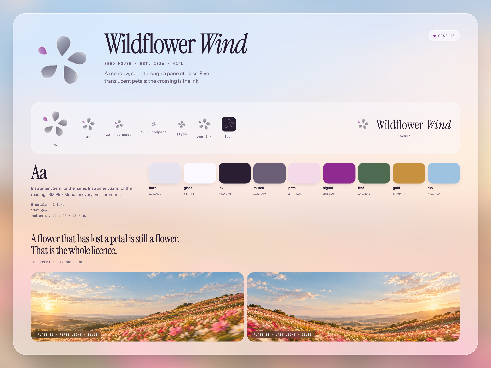

# Wildflower Wind

A brand kit and design system for a seed house, seen through glass. One idea: a meadow
is not arranged, it is scattered, and the scatter is the beauty.

Open **`index.html`**. It is the whole thing — one file, no build step, no network
requests, ten sections from the premise to the ledger.



## The idea

A seed house sells a future it cannot photograph, so the identity does not show the
flower. It shows the flower **through glass**: four petals still holding, one already
gone, and the crossing where they overlap gone dark.

The mark is not a drawing — it is a **placement table** of five petals, each with an
angle, a base radius, a length, a width and a bend. Four hold the calyx at 74°, 72° and
80°; the fifth sits 134° away, small, further out. What makes it glass is the fill: a
petal is a translucent lens, so two that cross multiply, and the darkest thing in the
mark is the crossing rather than a stroke.

The interface follows the same rule. Every surface is a pane — translucent, rounded,
one lit edge, one long shadow — floating over a meadow blurred to 34px, which exists so
the glass has something to bend.

The one rule everything else obeys: **if it could be flattened onto white without
losing anything, it is wrong.**

## Read in this order

| File | What it is |
| --- | --- |
| `index.html` | the specimen. The primary artefact. |
| `brand/brief.md` | the six-line brief, the six concepts, and why five lost |
| `docs/wildflower-wind-design-system-audit.md` | what is proved, by which command, and what is not |
| `docs/wildflower-wind-qa.md` | the browser pass: overflow, dusk, 16px, reduced motion |
| `brand/wildflower-wind-board.png` | the board, 3000 × 2250 (1500 × 1125 at 2×) |
| `tokens/wildflower-wind.tokens.json` | the source. Everything else is generated. |
| `public/brand/wildflower-wind/DESIGN.md` | the tokens in Google's open format |
| `design/figma/wildflower-wind/` | the Figma plugin, its manifest, and `tokens.figma.json` |

## Check it

```bash
node scripts/build-tokens.mjs    # 15 pairs recomputed, 2 published as failing
node scripts/qa.mjs              # 14 browser checks at 1440 / 390 / dusk / reduced motion
```

The static gates live in the skill that generated this case:

```bash
node ~/.workbuddy-ai/skills/sunnyside-brand-system/scripts/gates.mjs \
  --slug wildflower-wind --root . --refs refs/
```

## Regenerate

Generated files are never edited by hand. Edit the source, then:

```bash
node scripts/build-tokens.mjs    # tokens.json + token CSS
node scripts/mark.mjs            # the 15 glass SVGs, the drift, the favicons
node scripts/build-specimen.mjs  # index.html, built from the app's own module CSS
node scripts/figma-export.mjs    # the Figma plugin and tokens.figma.json
node scripts/qa.mjs              # 17 browser checks
```

`scripts/variants.mjs` renders the bake-off sheet the mark was chosen from. It is kept
because a decision with no record is a preference.

## Structure

```
assets/photos/     the three plates (one field, three hours)
assets/fonts/      Instrument Serif, Instrument Sans, IBM Plex Mono — all SIL OFL
brand/             brief, DESIGN.md, board.html, the rendered board
docs/              audit, QA report, screenshots
features/          tokens.json and the generated token CSS — what the gates read
public/brand/      the mark family, wordmark, lockups, icon, drift, tokens, DESIGN.md
design/figma/      the generated plugin
app/               the route: layout.tsx registers the faces, page.html is the page
tokens/            the hand-authored source of truth
refs/              the sibling systems detach was measured against
scripts/           everything that generates anything
```

## Licence

The three photographs were supplied for this system and are not stock. The typefaces
are under the SIL Open Font License and ship in `assets/fonts/`. The mark, the
placement table and every SVG in `public/brand/` are generated by `scripts/mark.mjs`.
